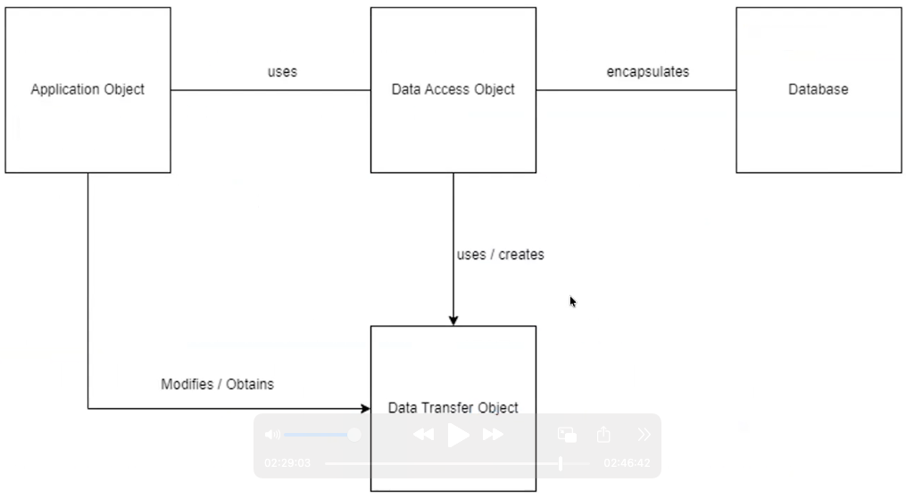

# Pattern DAO (Data Access Object)
E' un pattern, ossia un insieme di regole che ci diamo per interagire con un database
Il codice per interagire con il database implica una serie di conoscenze specifiche:
* Struttura del database
* Sintassi SQL

E' utile creare un layer di astrazione che renda indipendente la logica da questi dettagli, senza sapere che sotto c'è un database (o quale sia)
Incapsulamento dell'accesso al database in una classe separata distinta dal modello e dalla parte grafica (gestita tramite la view). 
  
E' simile al controller, fornisce una serie di metodi per operare sui dati. Fa solo quello. E' un modulo a parte. 
Il modello farà un `import` del DAO e lo utilizzerà.  
**Application** (funzionalità utente) --> **DAO** (metodi per fare le query) --> **Database**. 
  
Le classi che hanno bisogno di accedere al database vengono chiamate "client", non vogliono sapere i dettagli del DB. Le classi DAO ignorano gli obiettivi dell'utente finale e dell'applicazione, si specializzano solo nell'interfacciarsi con il DB.
Le classi DAO utilizzano degli oggetti per trasferire le informazioni, i DTO (Data Transfer Object)
Contengono solo dati, è comodo utilizzare le `dataclass` ed è buona pratica che abbiano i metodi `__eq__` e `__hash__` per confrontarli e ordinarli.
  
Alcuni punti importanti:
* IL DAO NON HA STATO, è un SINGLETON, non può essere istanziato
* Il dato **contiene** la **connection**
* Gestisce solo un tipo di dato, **uno per ogni database che utilizziamo**
* Fornisce dei metodi **CRUD**
* Aggiunge metodi di **ricerca**
* Restituisce sempre una collection di DTO